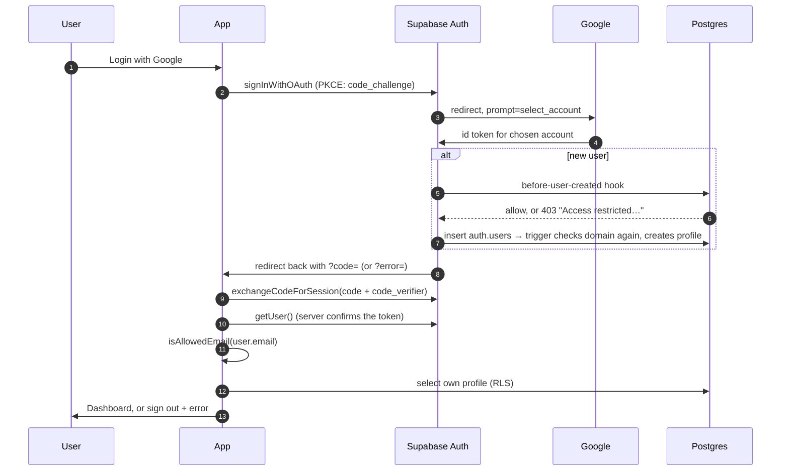

# HB+ Team Space

A cross-platform (Android, iOS, web) sign-in app for the HB+ team. Users log in with Google, and only `@hbplus.fit` accounts get through. Everyone else sees:

> Access restricted. Please login using your official domain email.

One codebase: Expo + React Native, with React Native for Web for the browser build.

**Live demo:** `<your-site>.netlify.app` &nbsp;·&nbsp; **Stack:** Expo SDK 58, Expo Router, Supabase (Auth + Postgres), Google OAuth 2.0, TypeScript

---

## Contents

- [Running it locally](#running-it-locally)
- [Authentication flow](#authentication-flow)
- [How the domain restriction works](#how-the-domain-restriction-works)
- [Roles](#roles-admin--member)
- [Protected routes](#protected-routes)
- [Token handling](#token-handling)
- [Project structure](#project-structure)
- [Tests](#tests)
- [Deploying to Netlify](#deploying-to-netlify)
- [Trade-offs and next steps](#trade-offs-and-next-steps)

---

## Running it locally

**You need** Node 22+, a Supabase project (the free tier is fine), and a Google Cloud project. For mobile you also need an Android emulator or the iOS Simulator, or the Expo Go app on a phone.

### 1. Google Cloud: OAuth client

1. In **APIs & Services → OAuth consent screen**, set the user type to **External**. Add the `openid`, `email` and `profile` scopes, then **publish** the app.
   - Don't pick *Internal*. Google would then refuse Gmail accounts on its own screen, so the app would never get the chance to show its own restriction message (which is the behaviour this assignment asks for).
2. In **Credentials → Create credentials → OAuth client ID**, choose **Web application**.
3. Under **Authorised redirect URIs**, add `https://<project-ref>.supabase.co/auth/v1/callback`.

### 2. Supabase

1. **Authentication → Providers → Google**: turn it on and paste in the client ID and secret.
2. **Authentication → URL Configuration**:
   - **Site URL:** your Netlify URL, or `http://localhost:8081` while developing.
   - **Redirect URLs:**
     ```
     http://localhost:8081/**
     https://<your-site>.netlify.app/**
     hbplusaccess://**
     exp://**
     ```
3. **SQL Editor**: run the two files in [`supabase/migrations/`](supabase/migrations) in order, each in a new query:
   - `20261123120000_domain_restricted_auth.sql`: domain rules, profiles, roles
   - `20261123130000_activity_log.sql`: activity log and dashboard numbers

   With the Supabase CLI you can run `supabase db push` instead.
4. **Authentication → Hooks → Before User Created**: choose *Postgres* and select `public.hook_before_user_created`.
   - This step is optional. Without it, the database trigger still blocks other domains, but the user gets Supabase's generic "Database error saving new user" error, which the app then maps to the restriction message.
5. After you sign in for the first time, make yourself an admin:
   ```sql
   update public.profiles set role = 'admin' where email = 'you@hbplus.fit';
   ```

### 3. App

```bash
npm install
cp .env.example .env      # fill in EXPO_PUBLIC_SUPABASE_URL and EXPO_PUBLIC_SUPABASE_KEY

npm run web               # http://localhost:8081
npm run android           # Android emulator
npm run ios               # iOS Simulator (macOS)
```

Use the **anon / publishable** key. Anything prefixed `EXPO_PUBLIC_` ends up in the bundle.

---

## Authentication flow



**Web.** A full-page redirect to Google and back to `/login`. `supabase-js` sees `?code=` in the URL and finishes the PKCE exchange. If Supabase rejected the account, the URL carries `?error_description=...` instead. The app reads that once, shows the message, and removes it from the address bar.

**Native.** `expo-web-browser` opens an auth session (`ASWebAuthenticationSession` on iOS, Custom Tabs on Android) and waits for the `hbplusaccess://login` deep link. The app then exchanges the code itself. The code verifier stays on the device.

**Verification after Google.** Every new session goes through `admit()` in [`auth-provider.tsx`](src/features/auth/auth-provider.tsx):

1. `getUser()` asks the auth server who the token belongs to. `getSession()` only reads local storage, so its result isn't trusted.
2. The email domain must match `@hbplus.fit` exactly.
3. The user's `profiles` row must be readable, and RLS only allows that for an allowed domain. This row is also where the role comes from.

If any of these checks fails, the app signs the user out locally, revokes the refresh token, and shows the error. Token refreshes for a user who has already passed don't re-run the checks.

---

## How the domain restriction works

The check runs in four places. Only the last three are real security; the client check is there so the user gets a fast, clear message.

| # | Where | What it does |
|---|---|---|
| 1 | **Client:** [`src/lib/domain.ts`](src/lib/domain.ts) | `isAllowedEmail()` runs on the user returned by `getUser()`. On a mismatch it signs the user out and shows the error. |
| 2 | **Auth hook:** `hook_before_user_created` | Supabase calls this before creating any user. A non-allowed domain gets a `403` with the restriction message, so no account is ever created. |
| 3 | **Trigger:** `handle_new_user` on `auth.users` | Raises an exception for a non-allowed domain. This still works if the hook isn't enabled. |
| 4 | **RLS:** policies on `profiles` | They check `auth.jwt() ->> 'email'`, so even a session that somehow exists for another domain reads nothing. |

The allowed domains live in a single table, `public.allowed_domains`. The hook, the trigger and the RLS policies all call `public.is_allowed_email()`, so they can't drift apart. To allow a second domain, add a row to the table and update `EXPO_PUBLIC_ALLOWED_DOMAIN`.

**Matching is exact.** The domain is everything after the last `@`, lowercased, and must equal the allowed domain. A plain `endsWith('hbplus.fit')` would let in `x@nothbplus.fit`. These cases are covered by tests on both the TypeScript and SQL side:

- `x@nothbplus.fit` → rejected
- `x@mail.hbplus.fit` → rejected
- `hbplus.fit@gmail.com` → rejected
- `"x@hbplus.fit"@gmail.com` → rejected
- `Example@HBPlus.fit` → allowed

**Why there's no `hd=hbplus.fit` parameter on the Google URL.** Google treats `hd` as a hint for its account picker, and anyone can delete it from the URL. It also stops a Gmail user from ever reaching our error message. Enforcement happens on the server instead.

---

## Roles (Admin / Member)

- The role is stored in `public.profiles.role` (`'user' | 'admin'`). It is **not** stored in `user_metadata`, because users can change their own metadata with `supabase.auth.updateUser()`.
- Clients have no `INSERT`, `UPDATE` or `DELETE` permission on `profiles` at all.
- Roles change only through `set_member_role()`, a `security definer` function. It checks that the caller is an admin on an allowed domain, and it refuses to let an admin change their own role. That also guarantees at least one admin always remains.
- RLS lets members read only their own row; admins can read every row.
- Admins see a **Team** page where they can search members and promote or demote them.

### Activity log

- `public.auth_events` records every real sign-in and every role change, including who made the change and the old and new roles.
- Rows are written only by database triggers and by `set_member_role()`. Clients have no insert, update or delete rights, so the app can't forge or erase entries.
- RLS shows admins the whole team's log (the dashboard feed and the Team page's audit log). Members see only their own entries.
- `team_overview()` returns counts only (members, admins, active this week). The dashboard can show the team's size without exposing anyone's profile to members.

---

## Protected routes

Routing uses Expo Router's `Stack.Protected` ([`src/app/_layout.tsx`](src/app/_layout.tsx)):

```tsx
<Stack.Protected guard={!signedIn}>
  <Stack.Screen name="login" />
</Stack.Protected>
<Stack.Protected guard={signedIn} redirectTo="/login">
  <Stack.Screen name="(app)" />          {/* /dashboard, /team */}
</Stack.Protected>
```

- Opening `/dashboard` directly while signed out redirects to `/login`.
- Opening `/team` as a member redirects to `/dashboard`.
- The navigator isn't mounted until the stored session has been restored. Without that, refreshing `/team` as an admin would briefly look signed-out and lose the URL.
- When a guard turns false (for example on sign out), Expo Router also removes those screens from history, so the Back button can't return to them.
- Netlify serves `index.html` for every path, so a direct URL still reaches the router's guards instead of a 404.

Client-side guards only control what the UI shows. The data is protected by RLS, so a user who skips the UI still gets nothing.

---

## Token handling

- **PKCE everywhere** (`flowType: 'pkce'`). No tokens ever appear in a URL.
- **Native:** the session is stored in the iOS Keychain or Android Keystore through `expo-secure-store`. SecureStore can reject values over about 2 KB, so [`auth-storage.ts`](src/lib/auth-storage.ts) splits the session into chunks and writes a count key last. A half-written session then reads back as "no session" rather than a corrupt one.
- **Web:** the session is in `localStorage` (the `supabase-js` default). That is readable by any script running on the page, which is the trade-off of a static SPA. The fix is cookie sessions from a server; see next steps.
- **Refresh:** `autoRefreshToken` is on. On native, refreshing pauses while the app is in the background and resumes when it's active again.
- **Sign out** uses `signOut({ scope: 'local' })`. This clears the device first and then revokes the refresh token on the server, so signing out still works offline.
- `getUser()` is used, not the cached session, whenever the app decides whether someone is allowed in.

---

## Project structure

```
src/
  app/                      # routes (Expo Router)
    _layout.tsx             # fonts, AuthProvider, top-level guards
    index.tsx               # → /dashboard or /login
    login.tsx
    (app)/
      _layout.tsx           # header + admin-only guard
      dashboard.tsx
      team.tsx              # admin only
  features/
    auth/                   # provider, Google sign-in (.ts native / .web.ts), error mapping
    dashboard/
    team/
  components/               # UI pieces shared across screens
  lib/                      # supabase client, domain check, storage, helpers
  theme/                    # colours, spacing, type
  types/
supabase/
  migrations/               # schema, RLS, hook, trigger, role function
  tests/                    # access-rule checks against an in-memory Postgres
```

Platform-specific behaviour uses `.web.ts` files (`google-sign-in.web.ts`, `auth-storage.web.ts`) instead of `Platform.OS` branches.

---

## Tests

```bash
npm test          # Jest: domain matching, URL parsing, error mapping
npm run test:db   # runs the migration on PGlite and checks the access rules
npm run typecheck
npm run lint
```

`test:db` creates users through the trigger and calls the hook as `supabase_auth_admin`. It then runs queries as `anon`, as a member, as an admin, and as a token carrying a non-allowed email, and checks that each sees or changes only what it should.

---

## Deploying to Netlify

[`netlify.toml`](netlify.toml) already contains the build command, the SPA fallback and the security headers.

1. Push to GitHub, then in Netlify choose **Add new site → Import from Git**.
2. Under **Site settings → Environment variables**, add `EXPO_PUBLIC_SUPABASE_URL`, `EXPO_PUBLIC_SUPABASE_KEY` and `EXPO_PUBLIC_ALLOWED_DOMAIN`.
3. Deploy, then add the site URL to Supabase's **Site URL** and **Redirect URLs**.

---

## Trade-offs and next steps

- **Check Google's `hd` claim on the server.** Today the check is on the email address. A consumer Google account can be registered with a work email, and the `hd` claim is only present on accounts managed by the Workspace. Checking it in the hook would close that gap.
- **Put the role in the JWT** with a Custom Access Token hook. That saves a query on every app start, at the cost of role changes only taking effect when the token refreshes.
- **Web sessions in httpOnly cookies** (server rendering or an edge function), plus a strict Content-Security-Policy.
- **End-to-end tests:** Playwright for web and Maestro for mobile, using Google test accounts.
- **Alerts on the audit log**, for example an email when someone is promoted to admin.
